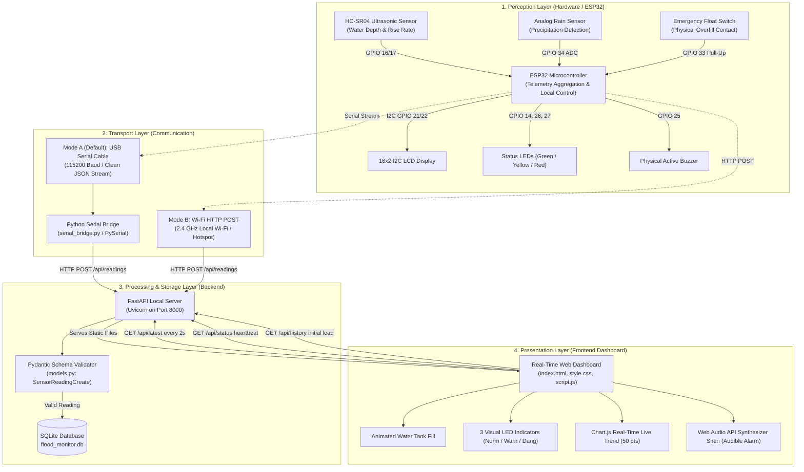
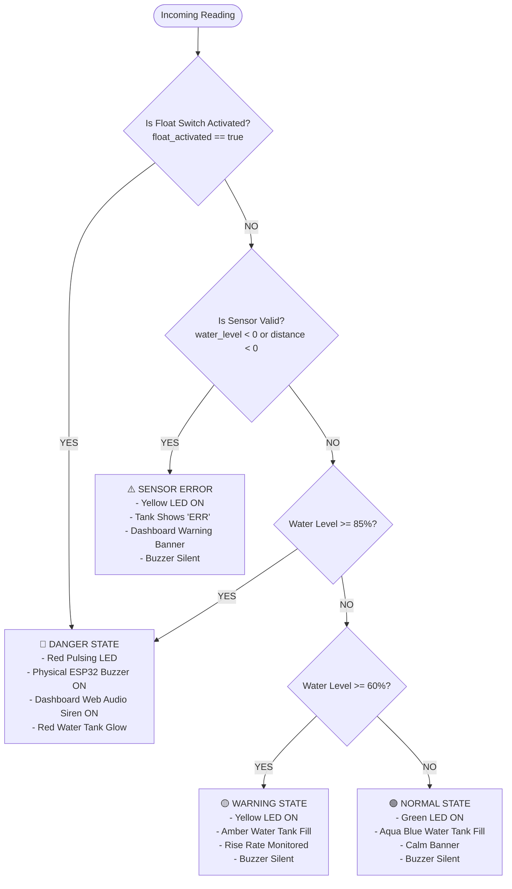

# 🌊 ESP32 Real-Time IoT Flood Monitoring & Early Warning System

An end-to-end, production-ready IoT flood monitoring and disaster mitigation system. The platform collects live environmental telemetry from an **ESP32 microcontroller**, forwards readings via a **USB Serial Bridge** or **Wi-Fi HTTP**, processes and catalogs data using a **FastAPI + SQLite** backend, and renders an interactive real-time dashboard powered by **HTML5, CSS3, Vanilla JavaScript, Chart.js, and the Web Audio API**.

---

## 📑 Table of Contents

1. [Executive Summary / Abstract](#-executive-summary--abstract)
2. [System Architecture Diagram](#-system-architecture-diagram)
3. [Hardware Components & Pinout Diagram](#-hardware-components--pinout-diagram)
4. [Complete Wiring Table & Electrical Schematics](#-complete-wiring-table--electrical-schematics)
5. [Data Flow & Telemetry Schema](#-data-flow--telemetry-schema)
6. [Alert Prioritization & Fail-Safe Logic](#-alert-prioritization--fail-safe-logic)
7. [Repository File Structure](#-repository-file-structure)
8. [Step-by-Step Installation & Run Guide](#-step-by-step-installation--run-guide)
9. [REST API Documentation](#-rest-api-documentation)
10. [Hardware Troubleshooting & FAQs](#-hardware-troubleshooting--faqs)

---

## 📖 Executive Summary / Abstract

Flooding is among the most frequent and devastating natural hazards worldwide. This project delivers a decentralized, low-cost, real-time IoT water level monitoring and early warning solution designed for urban drainage basins, riverbanks, water tanks, and flood-prone communities.

An **ESP32** microcontroller continuously samples:
- **Non-contact water distance & calculated depth** using an **HC-SR04** ultrasonic sensor.
- **Surface precipitation runoff** via an analog rain sensor.
- **Emergency overflow states** using a mechanical float switch.

Telemetry is serialized into JSON and piped at 2-second intervals to a local **FastAPI** service backed by an **SQLite** database. A responsive web client updates automatically every 2 seconds without page refreshes, providing a dynamic animated water tank visualizer, 3 distinct glowing LED status indicators, live Chart.js trend streaming, and an autonomous browser-based auditory buzzer alarm synthesized using the **Web Audio API**.

---

## 🏗️ System Architecture Diagram

The system follows a classic 4-tier IoT architecture: **Perception (Hardware)**, **Transport (Serial/Wi-Fi)**, **Processing (FastAPI/SQLite)**, and **Presentation (Web Dashboard)**.



---

## 🔌 Hardware Components & Pinout Diagram

### 1. Hardware Bill of Materials (BOM)

| Component | Quantity | Purpose | Operating Voltage |
|---|---|---|---|
| **ESP32 Dev Module** (30 or 38 pins) | 1 | Main IoT controller & sensor hub | 5V (via USB) / 3.3V Logic |
| **HC-SR04 Ultrasonic Sensor** | 1 | Non-contact water distance measurement | 5V (VCC to VIN) |
| **Raindrop / Rain Sensor (FC-37 / YL-83)** | 1 | Precipitation and rain detection | 3.3V (AO to ADC1) |
| **Liquid Float Switch** | 1 | Mechanical high-water fail-safe trigger | Logic GND (with internal pull-up) |
| **16x2 LCD with I2C Backpack (PCF8574)** | 1 | Local real-time display | 5V or 3.3V |
| **Active 5V Buzzer** | 1 | Physical high-pitch emergency alarm | 3.3V – 5V |
| **Standard 5mm LEDs (Green, Yellow, Red)** | 3 | Physical alert state indicators | 2.0V – 3.2V (via 220Ω resistors) |
| **220Ω Resistors** | 3 | Current limiting for LEDs | 1/4 Watt |
| **Solderless Breadboard & Jumper Wires** | 1 set | Circuit prototyping & interconnects | Standard |

---

### 2. ESP32 Pinout Diagram (Top View)

```text
                           ESP32 30-PIN DEV BOARD
                                +-----------+
                            EN -|           |- D23 (MOSI)
                  (ADC0)  VP/36 -|           |- D22 (SCL) ------> LCD SCL
                  (ADC3)  VN/39 -|           |- TX0
            Rain AO ----> D34   -|           |- RX0
                          D35   -|           |- D21 (SDA) ------> LCD SDA
           Float SW ----> D32/33-|           |- D19 (MISO)
                          D25   -|           |- D18
     Physical Buzzer <--- D25   -|           |- D5
         Green LED <----- D26   -|           |- TX2 (D17) ------> HC-SR04 TRIG
        Yellow LED <----- D27   -|           |- RX2 (D16) <------ HC-SR04 ECHO
                          D14   -|           |- D4
           Red LED <----- D14   -|           |- D2
                          D12   -|           |- D15
                          GND   -|           |- GND ------------> Common GND Rail
                          VIN   -|           |- 3V3 ------------> 3.3V Power Rail
                                +-----------+
                                   [ USB ]
```

---

## ⚡ Complete Wiring Table & Electrical Schematics

### 1. Pin-by-Pin Wiring Interconnect Table

> [!IMPORTANT]
> **HC-SR04 Power Rule:** Standard HC-SR04 sensors require **5V (VIN)** to trigger their acoustic transducers. Connecting HC-SR04 VCC to `3V3` will cause echo pulse timeouts (`duration = 0` / `-1.0 cm`).

| Sensor / Module | Module Pin | ESP32 Target Pin | Wire Color Recommendation | Notes & Circuit Requirements |
|---|---|---|---|---|
| **HC-SR04 Ultrasonic** | **VCC** | **VIN (5V)** | Red | Power from USB 5V rail |
| | **GND** | **GND** | Black | Connect to common ground |
| | **TRIG** | **GPIO 17** | Yellow | Ultrasonic transmit pulse output |
| | **ECHO** | **GPIO 16** | Blue | Echo receive pin *(5V to 3.3V divider optional)* |
| **16x2 I2C LCD** | **VCC** | **VIN (5V) / 3V3** | Red | Powers PCF8574 backpack and backlight |
| | **GND** | **GND** | Black | Connect to common ground |
| | **SDA** | **GPIO 21** | Green | ESP32 default hardware I2C Data line |
| | **SCL** | **GPIO 22** | Yellow | ESP32 default hardware I2C Clock line |
| **Emergency Float Switch** | **Terminal 1** | **GPIO 33** | White / Orange | Digital Input with `INPUT_PULLUP` enabled |
| | **Terminal 2** | **GND** | Black | Ground closure when float rises (Active LOW) |
| **Rain Sensor (Analog)** | **VCC** | **3V3** | Red | Powered by 3.3V rail for ADC compatibility |
| | **GND** | **GND** | Black | Connect to common ground |
| | **AO (Analog Out)**| **GPIO 34** | Brown | ESP32 ADC1 Channel 6 (Input-only pin) |
| | *DO (Digital Out)*| *Unused* | - | Leave disconnected (analog ADC used) |
| **Green Status LED** | **Anode (+)** | **GPIO 26** | Green | Via 220Ω current-limiting resistor |
| | **Cathode (-)**| **GND** | Black | Connect to common ground |
| **Yellow Status LED** | **Anode (+)** | **GPIO 27** | Yellow | Via 220Ω current-limiting resistor |
| | **Cathode (-)**| **GND** | Black | Connect to common ground |
| **Red Status LED** | **Anode (+)** | **GPIO 14** | Red | Via 220Ω current-limiting resistor |
| | **Cathode (-)**| **GND** | Black | Connect to common ground |
| **Active Buzzer** | **Positive (+)**| **GPIO 25** | Purple | Digital output alarm driver |
| | **Negative (-)**| **GND** | Black | Connect to common ground |

---

### 2. Breadboard Electrical Schematic Diagram

```text
 +5V USB (VIN) Rail --------------------------------------------+-----------------------+
                                                                | (VCC)                 | (VCC)
 +3.3V Power Rail   ----+                                    [HC-SR04]                [I2C LCD]
                        | (VCC)                                 | (GND)                 | (GND)
 Common GND Rail    ----+---------------------------------------+-----------------------+
                        |                                       |                       |
                 [Rain Sensor]                                  | (TRIG)                | (SDA)
                    | (AO)      [Float Switch]                  |                       |
                    |              | (Terminal 1)               | (ECHO)                | (SCL)
                    |              |                            |                       |
                    v              v                            v                       v
               +-----------------------------------------------------------------------------+
               | GPIO 34      GPIO 33           GPIO 17      GPIO 16      GPIO 21    GPIO 22 |
               | (ADC In)    (Pull-Up In)     (Trig Out)    (Echo In)    (I2C SDA)  (I2C SCL)|
               |                                                                             |
               |                                ESP32                                        |
               |                                                                             |
               | GPIO 26             GPIO 27             GPIO 14                 GPIO 25     |
               | (Green LED)       (Yellow LED)         (Red LED)               (Buzzer Out) |
               +-----------------------------------------------------------------------------+
                    |                   |                   |                        |
                   [220Ω]              [220Ω]              [220Ω]                    | (+)
                    |                   |                   |                        v
                  (Anode)             (Anode)             (Anode)                [BUZZER]
                 (GREEN LED)         (YELLOW LED)        (RED LED)                   | (-)
                  (Cathode)           (Cathode)           (Cathode)                  |
                    |                   |                   |                        |
 Common GND Rail ---+-------------------+-------------------+------------------------+
```

---

## 📡 Data Flow & Telemetry Schema

The ESP32 serializes all physical measurements into a single-line JSON string every 2000 milliseconds:

### Sample Telemetry JSON Payload

```json
{
  "water_level_percent": 74.25,
  "water_depth_cm": 22.28,
  "distance_cm": 7.72,
  "water_rise_rate": 0.150,
  "rain_value": 3120,
  "rain_detected": false,
  "float_activated": false,
  "status": "WARNING"
}
```

### Telemetry Field Reference

| Key | Type | Unit | Description |
|---|---|---|---|
| `water_level_percent` | `float` | `%` | Percentage filled: `((TANK_HEIGHT - distance) / TANK_HEIGHT) * 100` |
| `water_depth_cm` | `float` | `cm` | Calculated water height in the tank |
| `distance_cm` | `float` | `cm` | Measured ultrasonic flight distance from sensor face to surface |
| `water_rise_rate` | `float` | `%/s` | Derivative rate of water level change over time ($\Delta \text{Level} / \Delta t$) |
| `rain_value` | `int` | `ADC (0-4095)` | Raw 12-bit analog reading from rain sensor plate |
| `rain_detected` | `bool` | `true/false` | Boolean precipitation flag (true when `rain_value < 2000`) |
| `float_activated` | `bool` | `true/false` | Emergency mechanical float switch trip state |
| `status` | `string` | Enum | Alert categorization: `NORMAL`, `WARNING`, `DANGER`, or `SENSOR_ERROR` |

---

## 🚨 Alert Prioritization & Fail-Safe Logic

To prevent false negatives and guarantee public safety, alert evaluation follows a **strict hierarchical cascade**:



### Alert Decision Truth Table

| Condition | Primary Cause | Physical LED | Tank Color | Physical Buzzer | Browser Siren |
|---|---|---|---|---|---|
| **DANGER** | `float_activated == true` **OR** `water_level >= 85%` | 🔴 **RED** (Pulsing) | Crimson Red | **ACTIVE (BEEP)** | **ACTIVE (880Hz / 920Hz)** |
| **WARNING**| `60% <= water_level < 85%` | 🟡 **YELLOW** | Amber Yellow | Silent | Silent |
| **NORMAL** | `0% <= water_level < 60%` | 🟢 **GREEN** | Aqua Blue | Silent | Silent |
| **ERROR**  | `water_level < 0` (Echo Timeout) | 🟡 **YELLOW** | Grey / Empty | Silent | Silent |
| **OFFLINE**| No telemetry for `> 10.0 seconds` | All OFF | Standby | Silent | Silent |

---

## 📁 Repository File Structure

```text
floodmonitoring/
│
├── backend/
│   ├── main.py              # FastAPI application, CORS middleware & static file hosting
│   ├── database.py          # SQLite schema creation, thread-safe connection & queries
│   ├── models.py            # Pydantic schemas validating telemetry & enforcing status logic
│   └── flood_monitor.db     # Relational database storing persistent historical telemetry
│
├── frontend/
│   ├── index.html           # Dashboard UI: tank visualizer, LEDs, sensors, charts, audio controls
│   ├── style.css            # Responsive layout, glowing radial LED bulbs, animated tank waves
│   └── script.js            # 2s polling loop, Chart.js live stream, Web Audio API danger siren
│
├── esp32_firmware_sample.ino # Ready-to-upload Arduino C++ sketch (USB Serial & Wi-Fi support)
├── serial_bridge.py         # PySerial daemon piping ESP32 USB telemetry to FastAPI
├── simulate_esp32.py        # Hardware-free simulator script generating realistic telemetry
├── requirements.txt         # Python dependencies (fastapi, uvicorn, pydantic, pyserial, requests)
└── README.md                # Comprehensive system documentation, wiring & architecture manual
```

---

## 🚀 Step-by-Step Installation & Run Guide

### Step 1: Install Python Dependencies

Open your terminal in the project directory:

```bash
pip install -r requirements.txt
```
*(On macOS, if `pip` is not aliased, run `pip3 install -r requirements.txt` or `python3 -m pip install -r requirements.txt`).*

---

### Step 2: Flash the ESP32 Firmware

1. Connect your ESP32 to your computer using a USB-A / USB-C data cable.
2. Open **Arduino IDE**.
3. Install the required LCD library:
   - Go to **Sketch** → **Include Library** → **Manage Libraries...**
   - Search for **`LiquidCrystal I2C`** (by Frank de Brabander or Marco Schwartz) and click **Install**.
4. Open [`esp32_firmware_sample.ino`](file:///Users/manyashah/StudioProjects/floodmonitoring/esp32_firmware_sample.ino).
5. Select your board (**Tools** → **Board** → **ESP32 Arduino** → **ESP32 Dev Module**) and your serial port (e.g. `/dev/cu.usbserial-0001` on macOS or `COM3` on Windows).
6. Click **Upload**.
7. ⚠️ **Critical Rule:** Once upload completes, **close the Arduino IDE Serial Monitor**. Only one process can bind to a USB COM port at a time.

---

### Step 3: Run the FastAPI Backend Server

Open **Terminal 1** and start the backend:

```bash
uvicorn backend.main:app --host 127.0.0.1 --port 8000
```
- Open `http://localhost:8000` in your web browser.
- The dashboard will display **`ESP32 OFFLINE`** until telemetry begins flowing.

---

### Step 4: Start the USB Serial Bridge

Open **Terminal 2** and start the serial bridge:

```bash
python3 serial_bridge.py
```

The bridge will detect your ESP32 port, initialize communication at 115200 baud, and begin forwarding readings:

```text
=================================================================
   🌊 ESP32 USB Serial Bridge -> FastAPI
=================================================================
Target Serial Port : /dev/cu.usbserial-0001
Baud Rate          : 115200
FastAPI Endpoint   : http://127.0.0.1:8000/api/readings
=================================================================
✅ ESP32 connected successfully over USB!
Awaiting sensor data...

[OK] Level: 35.0% | Rate: 0.00%/s | Status: NORMAL -> Backend 201
[OK] Level: 35.2% | Rate: 0.10%/s | Status: NORMAL -> Backend 201
```

---

### Step 5: Enable Dashboard Sound Alerts

1. Switch back to your browser at **`http://localhost:8000`**.
2. Within 2 seconds, the badge switches to 🟢 **`ESP32 ONLINE`**.
3. In the top-right header, click **"🔊 Enable Sound Alerts"**.
   - Your browser will play an immediate confirmation chime.
   - If a **DANGER** reading or emergency float switch activation occurs, an audible pulsing warning siren will play through your computer speakers.
   - Use the **"🔔 Test Sound"** button to verify your speakers anytime.

---

### 🧪 Optional: Hardware-Free Testing with the Simulator

If your ESP32 is not currently connected to physical sensors, you can test the entire dashboard using the included simulator in **Terminal 3**:

```bash
python3 simulate_esp32.py
```
- Select **`1`** to inject a **NORMAL** reading ($35.0\%$).
- Select **`2`** to inject a **WARNING** reading ($72.5\%$).
- Select **`3`** to inject a **DANGER** reading ($90.0\%$ with active float switch).
- Select **`4`** to run a continuous dynamic loop simulating rising, cresting, and receding floodwaters.

---

## 📡 REST API Documentation

| HTTP Method | Endpoint | Description | Sample Output |
|---|---|---|---|
| `POST` | `/api/readings` | Receives and validates JSON telemetry from ESP32 / Bridge, persisting to SQLite | `{"status": "success", "id": 105}` |
| `GET` | `/api/latest` | Returns the most recent sensor reading with server timestamp | `{"reading": {...}, "server_time": "..."}` |
| `GET` | `/api/history?limit=100` | Returns latest chronological readings for Chart.js streaming | `[{"id": 1, ...}, {"id": 2, ...}]` |
| `GET` | `/api/status` | Returns ESP32 heartbeat (`online: true` if last seen $\le 10\text{s}$) | `{"online": true, "last_seen_seconds_ago": 1.2}` |
| `GET` | `/` | Serves the HTML5 dashboard frontend | Web Page Response |

---

## 🔧 Hardware Troubleshooting & FAQs

### 1. The dashboard displays `SENSOR ERROR` or `-1.0` distance
- **Root Cause:** The HC-SR04 ultrasonic sensor did not receive an echo pulse before the timeout window expired.
- **Fix 1 (Power Voltage):** Ensure HC-SR04 **VCC** is connected to **`VIN` (5V)**, not `3V3`. The acoustic transducers cannot operate reliably on 3.3V.
- **Fix 2 (Pin Swap):** Verify that **`TRIG`** is connected to **GPIO 17** and **`ECHO`** is connected to **GPIO 16**.
- **Fix 3 (Physical Obstacle):** Place your hand or an obstacle 10–15 cm in front of the sensor. If the sensor is pointing into open space beyond `TANK_HEIGHT_CM` (30 cm), the firmware marks the reading as out-of-bounds.

### 2. `serial_bridge.py` reports `[Errno 16] Resource busy: '/dev/cu.usbserial-0001'`
- **Root Cause:** Another process has an exclusive lock on the USB serial port.
- **Fix:** Close the **Arduino IDE Serial Monitor** window/tab. Only one program can read from the ESP32 at a time.

### 3. The browser dashboard does not make sound during DANGER
- **Root Cause:** Modern web browsers (Chrome, Edge, Safari) prohibit background audio autoplay until a user gesture occurs on the page.
- **Fix:** Click the **"🔊 Enable Sound Alerts"** button in the top-right header of the web page.

### 4. Port 8000 Address Already in Use (`[Errno 48]`)
- **Fix (macOS/Linux):** Terminate the lingering process occupying port 8000:
  ```bash
  kill -9 $(lsof -t -i :8000)
  ```
